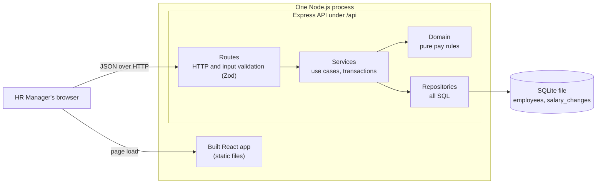
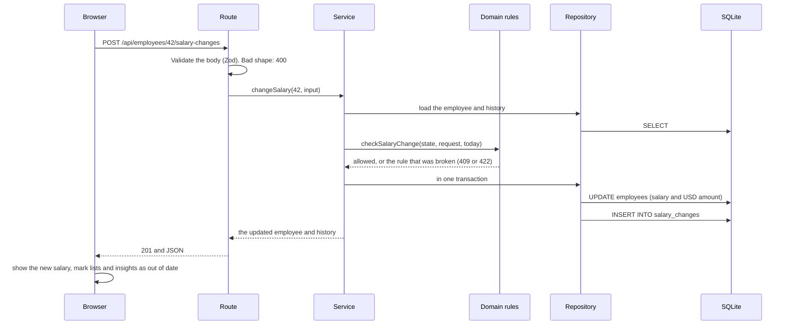
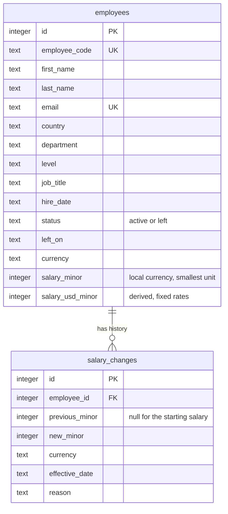

# Architecture

## The whole system
One Node.js process serves both the API and the built React app. The data lives in one SQLite file next to it.

## The layers on the server
A request moves down through four layers, and each layer knows only the one below it.

| Layer | Folder | Job | Knows about |
|---|---|---|---|
| Routes | `server/src/routes` | Read the request, check its shape with a Zod schema, call a service, send JSON. | HTTP |
| Services | `server/src/services` | One function per use case. Load data, ask the rules, write in a transaction. | The rules and the repository |
| Domain | `server/src/domain` | The pay rules: money, statistics, outliers, salary change rules, insights. Pure functions. | Nothing outside itself |
| Repositories | `server/src/repositories` | Every SQL statement in the app. | The database |

Why this split:
- **The rules are testable in isolation.** The domain folder imports no database and no web framework, so its tests run in milliseconds and cannot break for technical reasons.
- **SQL is in one place.** Moving to PostgreSQL would change the repositories folder and `db`, and nothing else.
- **Dependencies are passed in.** `createApp` receives the database and the clock. Tests pass an in-memory database and a fixed time, which is what makes them deterministic.

## What happens when a salary changes

## The web app
| Part | Folder | Job |
|---|---|---|
| Pages | `web/src/pages` | One per screen: employee list, employee detail, add employee, insights. |
| Components | `web/src/components` | The dialogs and shared form pieces. |
| API | `web/src/api` | The only code that calls `fetch`, plus the TanStack Query hooks that cache server data. |
| Format | `web/src/format` | Turning minor units and ISO dates into text, and typed text back into minor units. |

Two choices worth knowing:
- **Server data is not copied into component state.** TanStack Query holds it, keyed by the request. After a change, the affected keys are marked as out of date and reload when next shown.
- **Filters live in the address bar.** The employee list reads its search, filters, sort and page from the URL, so a view can be bookmarked and the back button works.

## Data model

Countries, currencies, exchange rates, departments and levels are fixed lists in code (`server/src/domain/reference.ts`), not tables. They change rarely, and a change should go through review.

## Where each decision is explained
The reasons behind these choices, with the options that were turned down, are in [DECISIONS.md](DECISIONS.md).
